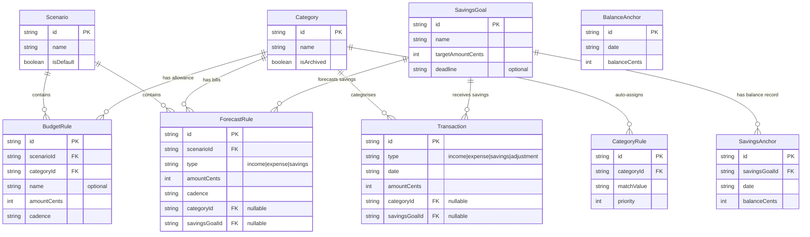
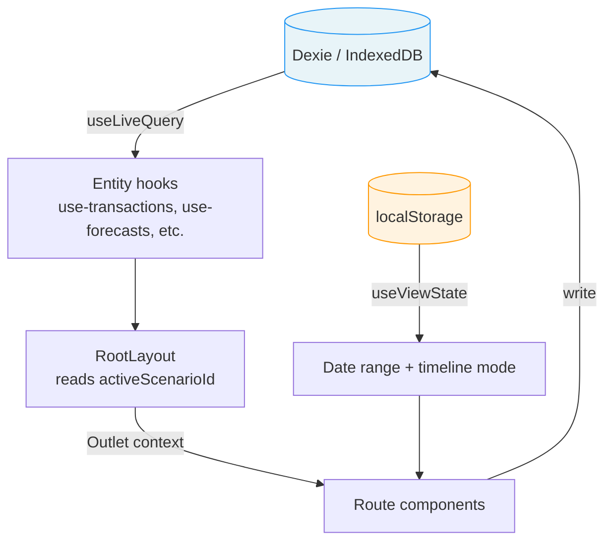
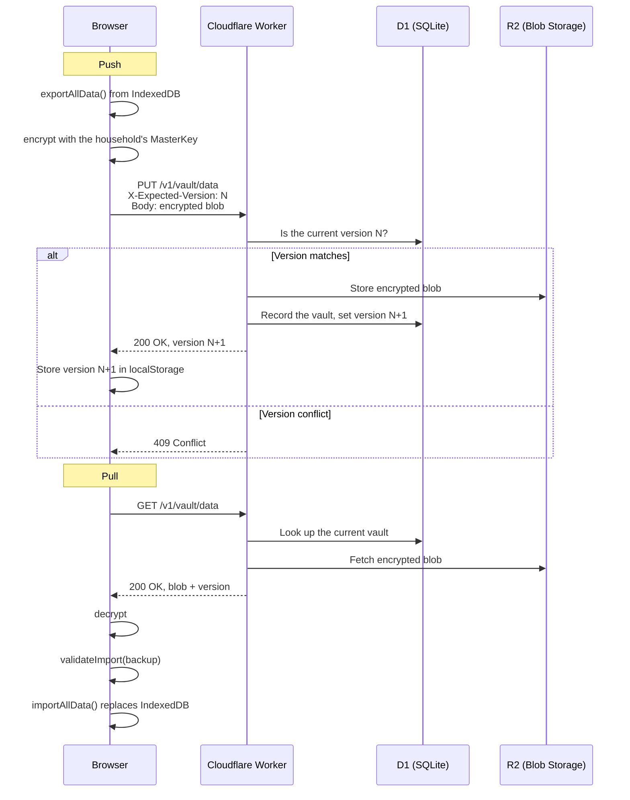

# Architecture

## What is SafelySpend?

SafelySpend is a personal budgeting app that answers one question: **"How much can I safely spend?"**

It separates **facts** (transactions you have already made) from **plans** (scenarios holding bills, income and allowances). You can keep more than one scenario and switch between them.

The app is local-first: all budget data lives in IndexedDB in the browser. An optional account keeps an end-to-end encrypted copy in the cloud, which is how a second device, or a second person in the same household, gets the same budget.

In beta (0.x). AUD-centric with Australian financial year defaults (1 July to 30 June).

Words: the UI says **bill** for a recurring expense and **allowance** for a category's spending limit. The code still says forecast rule and budget rule.

A bill is a commitment: a known amount on a known date. An allowance is a limit on spending that is decided day to day. Income less bills less savings is what is left, allowances divide that up, and the rest is surplus. A category can have both, and an allowance is in addition to the category's bills, so its limit is the two added together.

## Domain model

All entities share base fields: `id`, `userId`, `createdAt`, `updatedAt`. Amounts are integer cents. Dates are ISO strings. `src/lib/types.ts` is the data dictionary.

### Global entities (facts)

These exist independent of any scenario:

- **Category**: expense categorisation. Has an `isArchived` flag.
- **Transaction**: actual income, expenses, savings and adjustments. Types: `income`, `expense`, `savings`, `adjustment`.
- **SavingsGoal**: a savings target with an optional deadline, interest rate and compounding schedule.
- **BalanceAnchor**: a known cash balance on a date (the opening balance, or a reconciliation).
- **SavingsAnchor**: a known balance on a date for one savings goal.
- **CategoryRule**: an import rule that assigns a category to imported transactions.

### Scenario-scoped entities (plans)

These belong to one scenario:

- **Scenario**: a named plan. One is marked `isDefault`.
- **BudgetRule**: an allowance, which is a spending limit for a category, with a cadence and an optional `name`. A category can hold several, each at its own cadence, and spending is measured against their total. On the Budget page an allowance and a bill are both an expense, added and edited in one dialog: an expense with a due date is saved as a bill and one without as an allowance, and switching the due date on or off moves it between the two tables under a new id. The expense dialog refuses a second allowance of the same name in a category, counting no name as a name, so two allowances in a category can always be told apart.
- **ForecastRule**: recurring income, a bill, or a savings transfer, with a cadence and the day it lands on.

### Computed types

- **ExpandedForecast**: one dated occurrence of a forecast rule, produced by expanding the rule over a date range.

### Cadence system

Rules use a `Cadence` type: `weekly | fortnightly | monthly | quarterly | yearly`.

A forecast rule also says which day it lands on:

- `dayOfWeek` (0-6) for weekly and fortnightly
- `dayOfMonth` (1-31) for monthly, quarterly and yearly
- `monthOfQuarter` (0-2) for quarterly
- `monthOfYear` (0-11) for yearly

An allowance has a cadence and nothing else: it runs on calendar periods.

Expansion of forecast rules into dated occurrences lives in `src/lib/cadence.ts`. A category's limit for a month, which is its bills due that month plus its allowance, is worked out in one place: `src/lib/category-limits.ts`.

### Entity relationships

## Where data lives

### IndexedDB (Dexie)

The primary data store. Nine entity tables plus two config singletons (`appConfig`, `activeScenario`). Reads are reactive through `useLiveQuery()` from `dexie-react-hooks`.

Database name: `BudgetApp`. The schema version history is in the header of `src/lib/db.ts`.

Data in IndexedDB is not encrypted. The privacy page says so.

### localStorage

UI preferences and sync bookkeeping only, never budget data. Keys are defined in `src/lib/storage-keys.ts`, all prefixed with `budget:`:

- `budget:viewState`: date range and timeline picker state
- `budget:theme`: light or dark theme
- `budget:demoPersonaId`: the selected demo persona
- `budget:checkInNudgeDismissed`: whether the check-in banner was dismissed
- `budget:syncLocalVersion`: the vault version this device last synced
- `budget:syncLastSyncedAt`: when it last synced

### What leaves the device

Almost nothing, and only when asked:

- **Cloud sync** (opt-in): an encrypted blob. Encryption happens on the device; the server holds ciphertext it cannot read.
- **Landing page analytics**: a single pageview for visitors who have not set the app up yet. No budget data, no cookies, nothing identifying. It fires from exactly one place, `src/lib/analytics.ts`, called only by the landing page. Nothing inside the app is measured.

Everything else stays in IndexedDB and localStorage on the device.

### URL state

Route params (for example `/categories/:id`), plus a few query parameters used for navigation: `?section=` opens a section of the Budget page, and `?from=` tells a Back link where to return. Filters are not kept in the URL.

### React state

- **Key vault**: `src/lib/key-vault.ts` holds the keys of an unlocked session in memory. Nothing in it is persisted.
- **Form state**: mostly `useState` per field inside each dialog.

## State flow

How data moves from storage to the screen:

1. **Dexie is the source of truth.** `useLiveQuery()` in the hooks gives reactive data: when the database changes, components re-render.
2. **RootLayout** reads `activeScenarioId` from `useScenarios()` and passes it to its children through `<Outlet context={}>`.
3. **Route components** call hooks with `activeScenarioId` to get that scenario's rules.
4. **useViewState** (localStorage) gives the date range used to filter transactions and expand forecast rules.

## Accounts, households and cloud sync

An account is optional. Without one the app is complete and nothing leaves the device.

- **An account** is an email address, a password, and a twelve-word recovery phrase issued at signup.
- **A household** owns one encrypted vault. A user belongs to exactly one household, and there is no leaving one short of deleting the account.
- **The vault** is the whole budget as one encrypted blob, stored in Cloudflare R2. Everyone in the household holds the key that opens it.

### Signing in

Signing up and signing in are one flow at `/login`.

1. The person enters an email. `POST /v1/auth/login` emails a six-digit code. The answer is the same whether or not the address has an account.
2. They enter the code. `POST /v1/auth/verify-otp` returns a short-lived pending token and the salt and parameters for a password proof.
3. The browser derives the proof from the password with Argon2id and sends it to `POST /v1/auth/login-complete`. The server compares it with the stored verifier and sets the session cookie. The password itself never leaves the device.
4. An address with no account carries on into choosing a password and being shown the recovery phrase, then `POST /v1/auth/signup`.

A forgotten password is reset with the recovery phrase. That path issues a restricted session. It can fetch the key bundle and store a new password, and it can read who it belongs to and log out. Every other route refuses it. `api-design.md` §3.9 describes it and the risk that was accepted with it.

### Keys

The scheme is specified in `crypto-design.md`. In outline: the vault is encrypted with the household's MasterKey, which is generated in the browser when the household is created. Each member stores the MasterKey on the server wrapped twice, once under a key derived from their password and once under a key derived from their recovery phrase. The server holds only wrapped keys and ciphertext.

Where it lives in the code:

- `src/lib/envelope.ts`: the byte codec. Each envelope's header is bound into the AES-GCM associated data. Version `2` is the only version byte it accepts.
- `src/lib/key-management.ts`: Argon2id and HKDF derivation, key generation, wrapping and unwrapping, and the vault encrypt and decrypt pair.
- `src/lib/key-vault.ts`: the in-memory holder for the keys of an unlocked session.
- `src/lib/account.ts`: builds and opens the key material for signup, login, recovery and joining.
- `src/lib/api-client.ts`: every call to the worker.

### Joining a household

A member invites someone by email from Settings. The invitee signs up from the emailed link, the existing member approves them, and the household key is handed over through the server, encrypted to the invitee's public key. Both people compare safety numbers so a tampered key is noticed.

### Sync

- **Sync is by hand.** Nothing pushes or pulls on its own.
- **Optimistic concurrency.** The `X-Expected-Version` header stops a push from silently overwriting a newer vault. If someone else pushed in between, the answer is 409.
- **No merge.** On a conflict the person chooses to pull, which replaces this device's budget, or to overwrite, which replaces the household's.
- **Every pull is validated** by `src/lib/import-schema.ts` before it touches IndexedDB, the same as a file import.
- **Orphan cleanup.** If the D1 write fails after the R2 upload, the R2 object is removed. A daily cron catches any that slip through.

## Backend (Cloudflare Workers)

A Hono app in `worker/`, deployed to Cloudflare Workers. `api-design.md` is the full design: schema, endpoint contracts, session lifecycle and error model.

- **Runtime:** Cloudflare Workers
- **Database:** Cloudflare D1 (SQLite), raw SQL in service functions
- **Blob storage:** Cloudflare R2
- **Email:** Resend

### Routes

All under `/v1`:

- `/auth/*`: login, verify the code, complete login, signup, signup with an invite, key bundle, recovery reset, logout, the current user, account deletion, and listing and revoking sessions
- `/vault/*`: metadata, upload and download of the encrypted blob, version history, and download of an earlier version
- `/invites/*`: issue, list, accept and revoke
- `/handoffs/*`: pending and incoming key handoffs
- `/households/*`: add a member, and rewrap a member's keys

### Tables

One migration, `worker/migrations/0001_initial.sql`:

- `users`, `auth_codes`, `auth_pending`, `sessions`, `rate_limits`
- `households`, `household_members`
- `user_keys`, `household_member_keys`
- `invites`
- `vaults`, `sync_state`

### Protections

- CORS restricted to `APP_URL`, plus localhost in development
- Security headers: `X-Content-Type-Options`, `Referrer-Policy`, `Strict-Transport-Security`
- Rate limiting backed by D1, per IP and per user
- A limit on failed codes, after which the code is invalidated
- A storage quota
- Structured JSON logging with request ids

## Fragile files

Correct, but easy to break. Change them only with a full understanding and with tests.

- **`src/lib/db.ts`**: the Dexie schema version chain. A wrong version bump or a bad upgrade can corrupt or lose people's data. Test an export and import round trip after any change.
- **`src/lib/import-schema.ts`**: the Zod schemas that validate file imports and every sync pull. Zod drops fields it does not know, so a field added to `types.ts` and forgotten here is silently stripped on the next pull.
- **`src/lib/envelope.ts`, `src/lib/key-management.ts`**: the encryption format. Vaults encrypted under it now exist, so a format change must still open them.
- **`worker/src/services/vault.ts`**: optimistic concurrency and orphan cleanup across D1 and R2, which cannot share a transaction.
- **`worker/src/middleware/auth.ts`, `worker/src/services/auth.ts`**: session verification and rotation, code storage, lockout. Security-critical.
## Trade-offs

- **Local-first with optional sync.** Works offline and the person owns their data. The cost is conflict handling, and that clearing browser storage loses a budget that was never synced or exported.
- **One blob, not per-record sync.** A simple protocol: one upload, one download. The cost is that it is all or nothing, with no merge when two people edit at once.
- **Dexie over localStorage.** Indexed queries and room for large datasets. The cost is a versioned migration story.
- **No ORM on the backend.** Few dependencies. The cost is hand-written SQL with no type checking.
- **`userId: 'local'` on every record.** A placeholder kept from before accounts existed. Household members share one vault, so records are not attributed to a person.
- **AUD only.** Shipped sooner. Currency and locale are not configurable.
- **Client-side encryption.** The server never sees the budget. The cost is that someone who loses both their password and their recovery phrase cannot be helped.
